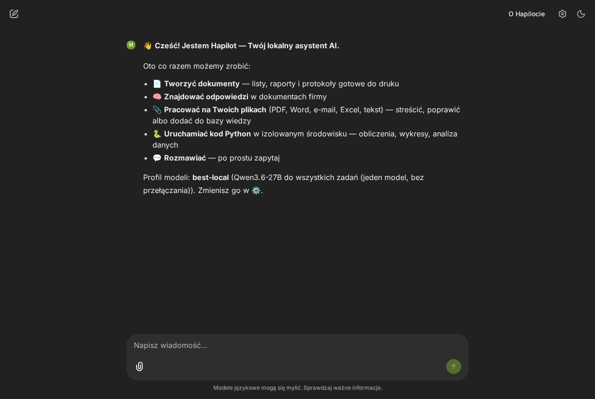
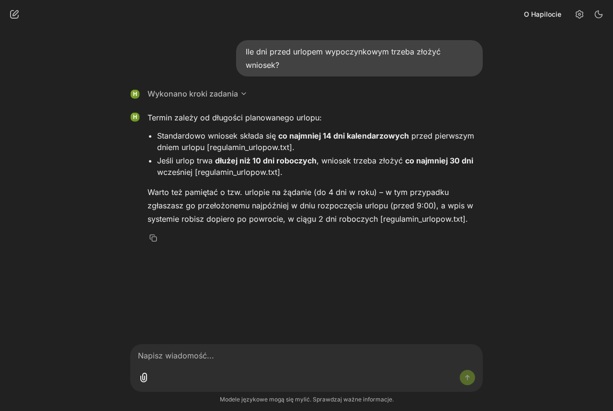
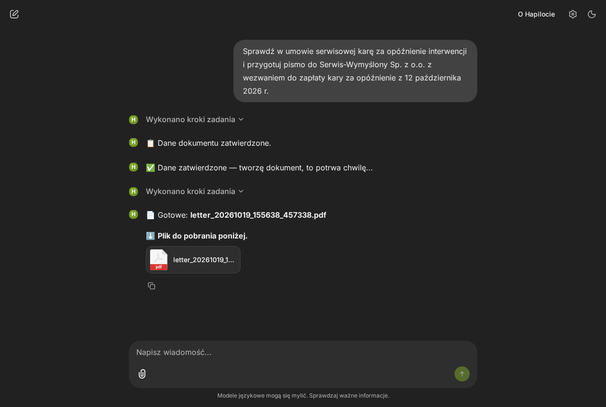
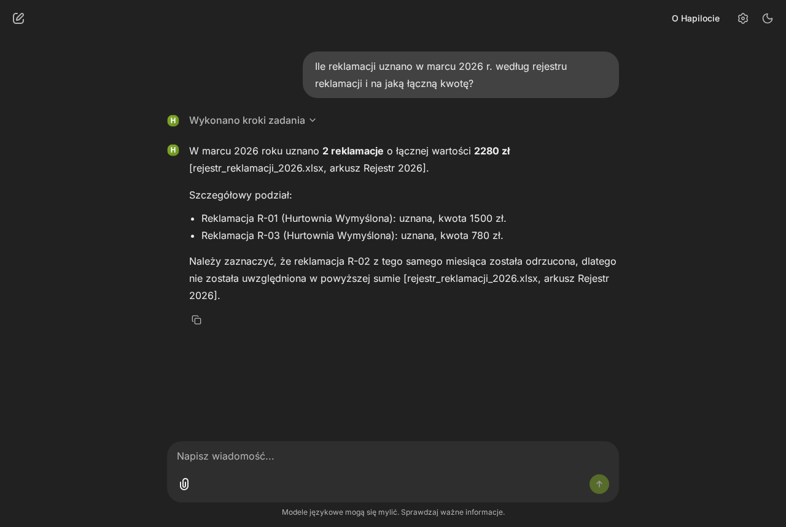
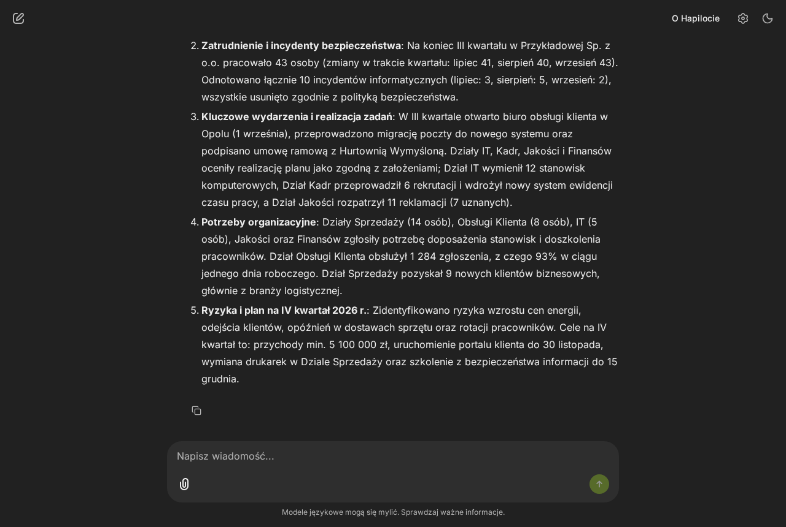
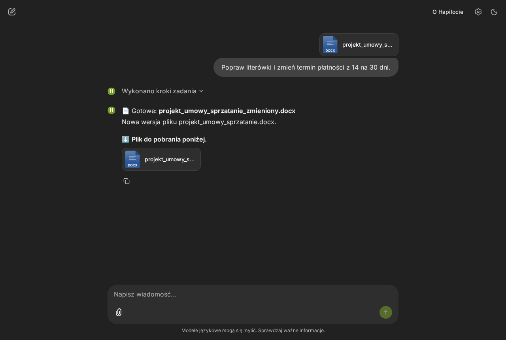
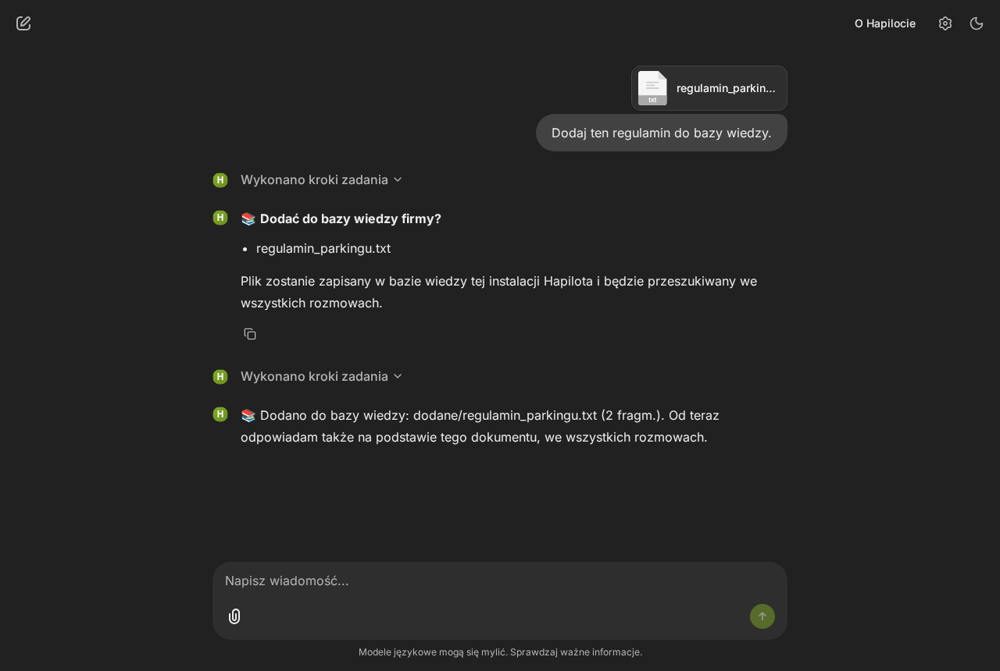
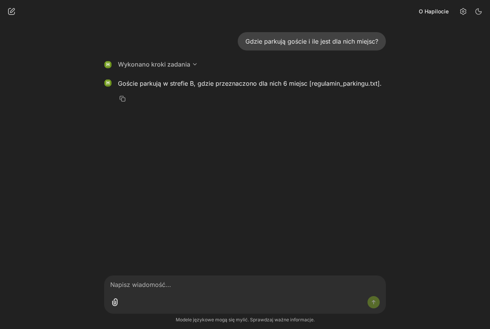

# Hapilot

A local multi-agent assistant for office work in Polish companies: it answers questions from company
documents, writes letters, reports and meeting minutes as PDF, edits them, works on files you upload
(summarises them, edits them, adds them to the knowledge base), and runs Python for calculations — with
local language models, on your own hardware.

- **Local by design.** Models run on your GPU host; the knowledge base is embedded; generated code and
  LaTeX run in a throwaway container without network. Model endpoints must be local/LAN addresses.
- **Orchestrated with LangGraph.** A planner splits a request into steps; each step goes to a
  specialised node (knowledge search, writer, document generator, Python coder, …).
- **Extensible.** Capabilities are extensions: a folder with a JSON manifest and Python nodes. The planner, router
  and graph are built from the manifests; a new tool needs no change to the core (example:
  [examples/extensions/vat_calculator](examples/extensions/vat_calculator)).

> Status: under active development. See [CHANGELOG.md](CHANGELOG.md). A scripted 10-minute demo is in
> [docs/demo.md](docs/demo.md).

## Screenshots

From the scripted demo ([docs/demo.md](docs/demo.md)) with the fictional demo company, profile `best-local` on an
RTX 4090, taken by [scripts/ui_demo.py](scripts/ui_demo.py) through the SSH tunnel (2026-10-19).

| | |
|---|---|
|  |  |
| Start screen | Answer from company documents, with sources |
|  |  |
| Search, then a letter as PDF (after the document form) | Calculation on a spreadsheet in the sandbox |
|  |  |
| Summary of an uploaded 10-page report | An uploaded Word file, corrected |
|  |  |
| Adding a file to the knowledge base (asks first) | Answer from the newly added document |

---

## How it works

```text
            Chainlit UI (127.0.0.1, open it through an SSH tunnel)
                                   │
                           ┌───────▼───────┐
                           │ task_planner  │  LLM → JSON plan of steps (+ guards, plan approval)
                           └───────┬───────┘
                           ┌───────▼───────┐
                           │    router     │  no LLM: step tool → node
                           └───────┬───────┘
   ┌──────────────┬──────────────┬─┴───────────┬────────────────────┬──────────────────┬──────────────────┐
knowledge       writer          chat     document_generator   modify_document     coder → execute    file tools
(RAG search)  (text, e-mail   (conver-   (LaTeX template,      (edit a document    (Python in the     (summarise, edit,
               drafts)         sation)    review form, PDF)     from this session)  sandbox, retries)  add to knowledge)
   └──────────────┴──────────────┴─────────────┴────────────────────┴──────────────────┴──────────────────┘
                                   │  next plan step, or end
```

| Part | What it is |
|---|---|
| Orchestration | LangGraph graph built from the loaded extensions ([src/agent_graph.py](src/agent_graph.py)) |
| Models | Any OpenAI-compatible local server; roles mapped to models by **profiles** ([config/profiles.yaml](config/profiles.yaml)) |
| Model serving | [tools/modelswap.py](tools/modelswap.py): one local endpoint that loads one llama.cpp model at a time |
| Knowledge base | ChromaDB embedded in the Hapilot process; hybrid search: `intfloat/multilingual-e5-base` vectors (CPU) and BM25, fused by reciprocal rank fusion; .pdf, .docx, .eml, .xlsx, .csv, .txt, .md; "which documents do you have?" is answered from the index itself (list of documents with pages and OCR pages) |
| Documents | LaTeX templates (letter, report, protocol) in [templates/](templates/), compiled to PDF in the sandbox; Polish text in the PDF can be copied and searched; short reports get a compact layout |
| Uploaded files | .pdf, .docx, .eml, .xlsx, .csv, .txt, .md attached in the chat (the model is told this list; images are not read yet): short ones go into the message, long ones are indexed for the session. Tools: summary of the whole file, editing (Word files keep styles, lists and tables), adding to the company knowledge base after confirmation ([extensions/file_tools](extensions/file_tools)) |
| Sandbox | Fresh Docker container per run: no network, non-root, read-only root filesystem, CPU/memory/process limits, timeout; the session's workspace is the only writable mount, company documents are readable at `/data` ([src/sandbox.py](src/sandbox.py)) |
| UI | Chainlit, per-session workspace and model profile, optional password login; a right-hand panel **📎 Źródła i pliki** shows the company documents behind each answer (PDFs as original pages, other formats as full text) with the fragments that went into the prompt highlighted, and the files the request created or changed (preview, diff, download) ([src/source_view.py](src/source_view.py)); those files — e.g. a chart saved by code, shown as an image — are also attached under the answer, and a file an answer names (asked for again) comes with it |

Human in the loop: under the default `ask` policy Hapilot asks before running plans longer than two
steps, shows document parameters in a form before generating a PDF, asks before adding a file to the shared
knowledge base, and stops at confirmation steps.
Scripts and evaluation runs use the `auto` policy.

## Model profiles

| Profile | Roles | Notes |
|---|---|---|
| `reference` | Bielik-11B v3 (Q8_0) for language roles, Qwen3-Coder-30B-A3B (Q4_K_M) for Python | The two models do not fit together on a 24 GB GPU; the proxy swaps them |
| `best-local` | Qwen3.6-27B (Q4_K_M, reasoning off) for all roles | One model, no swapping |

Measured on an RTX 4090 (24 GB) on 2026-10-18 with llama.cpp, q8_0 KV cache: VRAM Bielik-11B Q8_0 (32k context)
15,220 MiB, Qwen3-Coder-30B-A3B Q4_K_M (16k) 18,964 MiB, Qwen3.6-27B Q4_K_M (32k) 17,016 MiB. A swap takes 2–3 s when
the model file is in the page cache (first load from disk: 52 s for Bielik, 120 s for Qwen3-Coder). The seven smoke
scenarios took 82.6 s in total with `best-local` and 138.3 s with `reference` (all passed).

Time per path (chat, knowledge search, Python, documents, uploaded files) and per development task with both
profiles, measured on 2026-10-19: [docs/timing.md](docs/timing.md).

The default profile is `best-local` (set in `config/profiles.yaml`); users choose a profile per chat session in the
⚙️ panel. Adding a model is a configuration change (profiles + `config/models.local.yaml`), not a UI action.

## Privacy

What Hapilot does to keep data on your machines:

- model endpoints are checked against a local/LAN allowlist (`src/config.py`); there is no cloud model path;
- Hugging Face, Chroma and LangChain telemetry and downloads are switched off at run time (`src/privacy.py`);
  the embedding model is downloaded once during setup;
- the sandbox and the OCR containers (scanned PDFs) have no network; the UI, model proxy and optional n8n listen on 127.0.0.1 only — the UI is opened to
  the local network only when the operator sets `HAPILOT_UI_HOST` (with login and HTTPS,
  [docs/deployment.md](docs/deployment.md)); model servers always stay on 127.0.0.1;
- each chat session has its own workspace; files are never served across sessions (the side panel serves
  pages and downloads only through random per-session links, forgotten when the chat ends). A file a user adds to the
  knowledge base becomes searchable in every session of that installation; Hapilot asks before adding it.

The claim is tested, not only stated: `scripts/hapilotctl.py egress-test` runs the scenario suite with
the model server, the UI, indexing and the agent under `strace`, blocks non-local connections from
Hapilot's Python process, and fails on any outbound connection attempt (including DNS).
**Last egress test: passed on 2026-10-19, commit `c668641`, profiles `best-local` and `reference`** (11/11 scenarios
each, including uploaded files, editing them and adding one to the knowledge base; traced: model server, UI start-up
and page load, indexing, agent runs; no outbound connection, no DNS lookup; every sandbox run had network mode `none`). Not covered by the trace: the Docker daemon itself (root) and a full browser chat
session over the UI's websocket (the agent code it runs is the same as in the scenarios).

The optional n8n extension (Outlook e-mail drafts and calendar) is outside this claim: n8n talks to
Office 365 by design. It is disabled by default. So is the optional updater (`hapilotctl.py update`, for installs
that follow a git branch): it fetches from git and, when requirements change, from PyPI — never from the UI process.

## Running on a GPU host

Requirements: Linux with an NVIDIA GPU, Python 3.10+, Docker with Compose, llama.cpp's `llama-server`, GGUF model
files, `strace` (for the egress test). Verified on: RTX 4090 24 GB, Ubuntu, Python 3.12, Docker 29, llama.cpp from
LM Studio's CUDA 12 backend.

```bash
git clone https://github.com/majaszturmaj/Hapilot.git ~/Hapilot && cd ~/Hapilot
python3 -m venv .venv
.venv/bin/pip install torch==2.10.0 --index-url https://download.pytorch.org/whl/cpu
.venv/bin/pip install -r requirements.txt
.venv/bin/python scripts/hapilotctl.py setup     # sandbox and OCR images, embedding model, config/models.local.yaml
```

Edit `config/models.local.yaml` (paths to `llama-server` and the GGUF files), then:

```bash
.venv/bin/python scripts/hapilotctl.py up --profile best-local   # model proxy + knowledge base + UI
.venv/bin/python scripts/hapilotctl.py status
.venv/bin/python scripts/hapilotctl.py down
```

`hapilotctl` only stops processes it started itself (recorded in `var/run/`), refuses to start models
while another process uses the GPU, and refuses ports that are taken.

### Opening the UI

Everything binds to 127.0.0.1 on the GPU host. From your computer:

```bash
ssh -N -L 8601:127.0.0.1:8601 <user>@<gpu-host>
```

then open http://localhost:8601. To let colleagues open the UI in their browser on the local network — with
HTTPS, and updates that follow a git branch (tested, switched, rolled back on failure) — see
[docs/deployment.md](docs/deployment.md). For shared use, enable the login: `hapilotctl.py add-user NAME` and
set `HAPILOT_UI_USERS_FILE` in `.env`. With login on, chats are kept per user in
`var/chat_history.sqlite` (`HAPILOT_CHAT_DB`): past chats are listed in the left sidebar, each user sees
only their own, and a reopened chat continues with its earlier messages, workspace files and side panel
([src/chat_store.py](src/chat_store.py), [src/ui_history.py](src/ui_history.py)). Deleting a chat removes
it from the history together with its workspace files (`var/workspace/<chat id>/`) and its attachment index.

With login on, every user also gets the **agent panel** (`/hapilot/admin`, link in the chat header): the agent
graph drawn from the loaded extensions, and **custom nodes** — prompt-only nodes (one model call with their own
system prompt, model role and temperature; no code, no tools) that the planner can choose like any tool. A user's
custom nodes are private: they take part only in that user's chats. Administrators (`HAPILOT_UI_ADMINS`, default
`admin`) can switch their nodes to global (used in everyone's chats; only administrators edit or delete them) and
edit the prompts of the built-in nodes, with version history and restore; other users can read those prompts.
Changes are recorded in `var/admin_audit.jsonl` and apply to the UI only — evaluation runs use the repository's
extensions and prompts ([src/admin.py](src/admin.py), [src/ui_admin.py](src/ui_admin.py)).

The panel's **📄 Szablony** tab manages PDF document templates the same way: users build their own private
templates — with a block builder (title, sender, recipient, place and date, paragraphs, lists, tables, signature,
footer; same fonts and Polish setup as the built-in templates) or directly in LaTeX — with a live preview compiled in
the sandbox from the fields' example values; a template is saved only if it compiles. Administrators share theirs
globally and edit the built-in templates (with history and restore). Hapilot offers each user the built-in, global
and own templates; a request can name one („według szablonu Oferta handlowa”). Fields are `{{NAME}}` placeholders;
`{{NAME|lista}}`, `{{NAME|tabela:N}}`, `{{NAME|linie}}` and `{{NAME|akapity}}` format multi-line values
([src/doc_templates.py](src/doc_templates.py)).

**Signatures.** Documents have a signature place (`{{PODPIS_SLOT}}` in the built-in templates and the builder's
"Podpis" block). In the document form the user chooses a blank place to sign the printed document by hand
(default) or their own signature scan, uploaded once in the panel (**✍️ Mój podpis**: PNG or JPEG, up to 2 MB).
Scans are private — no other user, administrators included, can see or use them — and the model never chooses
the signature; without a form (evaluation) the place stays blank ([src/signatures.py](src/signatures.py)).

**Company look.** Administrators adapt the UI to the company in the panel's **🎨 Wygląd** tab, for every user at
once: the app's name (page title, login page, the assistant's name on messages and in the welcome text, the
"O aplikacji" page — which then credits Hapilot — and, in the system prompts, every form of "Hapilot"), a 1–2
sentence company description (added to the system prompts as a `[FIRMA]` section; not shown to users), a logo
(PNG or JPEG up to 1 MB; header and login page, and favicon and avatar when it is roughly square — otherwise the
name's first letter on the main colour) and the main colour. A live preview shows the result; versions are kept
with who and when, any of them can be restored, and Hapilot's look comes back with one click. UI only: evaluation
runs always run as Hapilot ([src/branding.py](src/branding.py), [src/ui_branding.py](src/ui_branding.py)).

**Knowledge base.** Administrators manage the documents the assistant answers from in the panel's **📚 Baza wiedzy**
tab: every document with its type, size, pages, chunks, pages read by OCR, who added it and when, and whether it is
indexed; the text the index got from it (per page, scans marked); download. They add documents (several at once or
by drag and drop, up to 50 MB each), which are saved into the company documents folder and indexed in the
background, OCR included; replace one with a new version; and delete one. Replaced and deleted files stay in a
trash for 30 days and can be restored. The UI re-checks the documents folder at start-up and every 5 minutes, so
files copied there on the server are picked up too. Only the changed documents are indexed, never the whole folder
again ([src/knowledge_admin.py](src/knowledge_admin.py)). Other users do not see the tab.

### Ports

| Port (127.0.0.1; the UI: `HAPILOT_UI_HOST`) | Service | Variable |
|---|---|---|
| 8601 | Chainlit UI | `HAPILOT_UI_PORT` |
| 8611 | Model swap proxy (OpenAI-compatible) | `HAPILOT_MODELSWAP_PORT` |
| 8612 | llama-server started by the proxy | `HAPILOT_BACKEND_PORT` |
| 8678 | n8n (optional, compose profile `n8n`) | `HAPILOT_N8N_PORT` |

Set the variables in `.env` (or the environment) when a port is taken; `hapilotctl` refuses to start on a
port that is in use and prints the tunnel command with the configured UI port (`hapilotctl.py tunnel`).

### Your documents

Put company documents (.pdf, .docx, .eml, .xlsx, .csv, .txt, .md) in a folder, set `HAPILOT_DOCS_DIR` in `.env`, and run
`hapilotctl.py ingest`. Scanned PDFs (pages without a text layer) are read by OCR — Tesseract with the Polish and
English models, in an offline container built by `setup`; `HAPILOT_OCR=off` switches it off. The recognised text is
only as good as the scan. The default is the fictional demo company in
[examples/demo_company/](examples/demo_company/) (shown in the panel, never changed by it). `data/private_docs/` is
ignored by git. Files that users add from the chat are kept in `var/added_docs/` (`HAPILOT_ADDED_DOCS_DIR`) and
indexed together with your documents (source path `dodane/…`). While the UI runs, it keeps the index up to date
itself — through the agent panel (**📚 Baza wiedzy**) or by re-checking the folder every few minutes — and
`hapilotctl.py ingest` refuses to run (the embedded database takes one writer).

## Evaluation (headless)

Benchmark harnesses run Hapilot without the UI through the evaluation interface
([docs/EVALUATION_INTERFACE.md](docs/EVALUATION_INTERFACE.md)): tasks in JSONL, a document corpus, the date to
treat as today and a profile in; answers, JSON answers, sources, created files and a full trace per task
(plan, every model and tool call, every retrieval with chunk texts, sandbox runs, approvals) out.

```bash
.venv/bin/python scripts/hapilotctl.py eval --tasks tests/eval/dev_tasks.jsonl --corpus examples/demo_company/docs \
    --today 2026-10-14 --profile best-local --out var/runs/dev
.venv/bin/python -m src.eval validate var/runs/dev
```

## Configuration

All settings are environment variables read by [src/config.py](src/config.py); see
[.env.example](.env.example) for the full list with defaults.

## Development

Unit tests need no model, GPU or network (a guard fails any test that tries to connect out):

```bash
python3 -m venv .venv && .venv/bin/pip install -r requirements-test.txt
.venv/bin/pytest
.venv/bin/ruff check src extensions examples tests scripts tools
```

GitHub Actions runs the unit tests (with a coverage gate) and lint only. With real models, on the GPU host:
`.venv/bin/python scripts/hapilotctl.py integration` runs the smoke scenarios, a planner check and the
development tasks for every profile and writes a report; `smoke --profile best-local` runs the smoke
scenarios alone. Details: [docs/testing.md](docs/testing.md).

Extensions: see [docs/extension_development.md](docs/extension_development.md). Architecture details:
[docs/architecture.md](docs/architecture.md). Optional MCP servers exposing the knowledge base, templates
and n8n operations: `python -m src.knowledge_server`, `src.template_server`, `src.operations_server`.

## License

[MIT](LICENSE) © 2026 Maja Szturmaj
